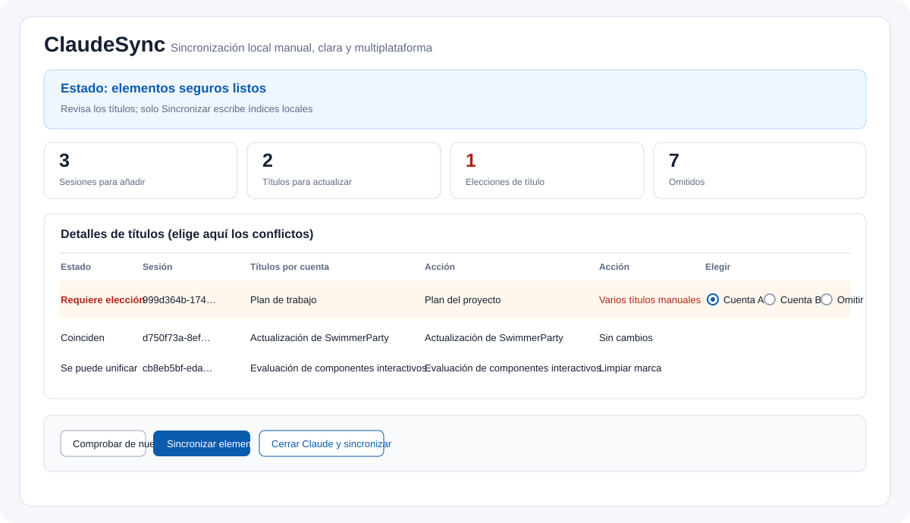

# ClaudeSync (Español)

**Míralo primero. Elige el título. Sincroniza solo cuando sea seguro.**

[English](README.md) · [中文](README.zh-CN.md) · [日本語](README.ja.md) · [Português](README.pt-BR.md)

ClaudeSync mantiene claras las listas locales de sesiones de Claude Code para **dos o más cuentas** en un mismo ordenador. Descubre las carpetas locales, muestra un plan, permite elegir los conflictos de título en la misma pantalla y solo escribe cuando Claude está cerrado. **Rol:** actualmente gratuito y primero para uso propio. **Tecnología:** GUI/CLI de escritorio en Python con navegador local de respaldo. **Estado:** versión pública v1.3.2.



> **Es una herramienta de índices locales, no de migración en la nube.** No inicia sesión, no lee contraseñas ni cookies, no sube conversaciones y no mueve Artifacts.

## Lo esencial

- **Descubrimiento automático.** La aplicación encuentra las cuentas del directorio de sesiones. La configuración manual queda como último recurso.
- **Una sola pantalla.** Estado, cuentas, cantidades, motivos omitidos y títulos aparecen juntos.
- **Una elección por conflicto.** Elige el título de cualquier cuenta o **Omitir**.
- **Sin automatización de fondo.** No hay ganchos de salida, vigilancia, temporizadores, inicio de sesión ni cambio automático de cuenta.
- **Escrituras protegidas.** Un Claude activo bloquea las escrituras; se crea una copia de seguridad y se verifica después.


## Sistemas y paquetes

| Sistema | Archivo |
| --- | --- |
| macOS Apple silicon | `ClaudeSync-macos-arm64.dmg` o `.zip` |
| macOS Intel | `ClaudeSync-macos-x64.dmg` o `.zip` |
| Windows 10/11 de 64 bits | `ClaudeSync-windows-x64-setup.exe` |
| Debian/Ubuntu de 64 bits | `ClaudeSync-linux-amd64.deb` |
| Otro Linux de 64 bits | `ClaudeSync-linux-amd64.tar.gz` |

Descarga desde [la última versión de GitHub](https://github.com/PieAIStudio/ClaudeSync/releases/latest). La interfaz incluye 简体中文, English, 日本語, Español y Português. Si Linux no tiene Tk, se abre la misma interfaz en el navegador local.

## Uso

1. **Abre ClaudeSync.** Primero detecta las cuentas locales. Si faltan carpetas, abre la configuración alternativa y añádelas allí.
2. **Comprueba.** Pulsa **Comprobar de nuevo**, lee las cantidades y revisa la tabla.
3. **Elige.** En cada fila con **Requiere elección**, elige una cuenta o **Omitir**.
4. **Sincroniza.** Cuando Claude termine, pulsa **Sincronizar elementos seguros** o **Cerrar Claude y sincronizar**.
5. Abre Claude manualmente y revisa la lista. El inicio de sesión y el cambio de cuenta siguen siendo manuales.

## Comportamiento de varias cuentas

Todas las cuentas configuradas son iguales. ClaudeSync crea una unión local segura: un `cliSessionId` se añade una sola vez a cada cuenta que lo necesita. Un marcador de borrado en cualquier cuenta evita que la sesión reaparezca. Las entradas archivadas, remotas, programadas o sin transcripción se muestran con su motivo y se omiten.

## Títulos

Los títulos iguales no cambian. Un único título manual puede propagarse a los títulos automáticos. Varios títulos manuales distintos aparecen en una fila para elegir cualquiera de las cuentas. Los títulos automáticos distintos no se adivinan. El título elegido también se usa en las entradas nuevas.

## Límites y recuperación

No se modifica el cuerpo JSONL, las entradas existentes, los borrados, los archivos, los proyectos, Artifacts, conectores, sesiones remotas, credenciales ni cookies. Antes de escribir se crea una copia privada y un manifest; después se verifica. Mantén privados `config.json`, `reports/` y `backups/` porque pueden contener rutas y nombres locales.

## Comandos

```sh
python sync_sessions.py --check
python sync_sessions.py --sync
python sync_sessions.py --close-sync
```

## Desarrollo

```sh
python -m unittest -v test_sessions test_platforms test_configuration
python -m compileall -q claudesync.py sync_gui.py sync_gui_tk.py sync_web.py sync_sessions.py claude_sync
```

Consulta [CONTRIBUTING.md](CONTRIBUTING.md), [SECURITY.md](SECURITY.md) y la [licencia MIT](LICENSE).
