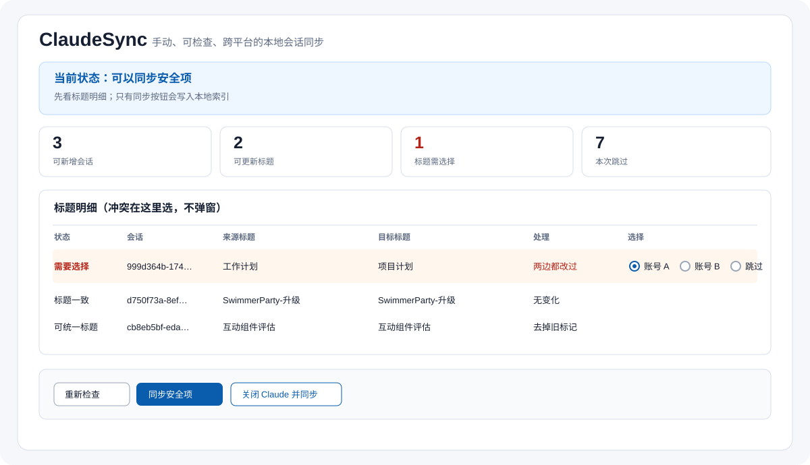

# ClaudeSync (Español)

**Míralo primero. Elige el título. Sincroniza solo cuando sea seguro.**

[English](README.md) · [简体中文](README.zh-CN.md) · [日本語](README.ja.md) · [Português](README.pt-BR.md)

ClaudeSync mantiene legibles las listas locales de sesiones de Claude Code cuando usas dos cuentas en el mismo ordenador. Muestra qué se puede añadir, explica qué se omite y permite elegir los conflictos de título en la misma tabla. Solo escribe cuando Claude ya está completamente cerrado.



> No es una migración a la nube: no inicia sesión, no lee contraseñas, no sube conversaciones y no mueve Artifacts.

## Instaladores

Descarga el paquete para macOS (Apple silicon o Intel), Windows 64 bits o Debian/Ubuntu desde [GitHub Releases](https://github.com/PieAIStudio/ClaudeSync/releases/latest). La interfaz permite elegir chino simplificado, inglés, japonés, español o portugués. El paquete de macOS incluye Python; en Linux sin Tk se abre automáticamente la interfaz local en el navegador.

## Empezar

Necesitas Python 3.9 o posterior.

```sh
git clone https://github.com/PieAIStudio/ClaudeSync.git
cd ClaudeSync
```

- macOS: doble clic en `Sync.command`
- Windows: doble clic en `Sync.bat`
- Linux: ejecuta `./Sync.sh`
- Cualquier sistema: `python sync_gui.py`

La primera vez, selecciona la carpeta raíz de los dos índices, las carpetas de Cuenta A y Cuenta B y la carpeta `projects` que contiene los JSONL locales.

1. Pulsa **Check**; es solo lectura.
2. En cada fila roja elige Cuenta A, Cuenta B o **Skip**.
3. Guarda tu trabajo de Claude y pulsa **Sync safe items** o **Close Claude and sync**.
4. Abre Claude y comprueba la lista. El inicio de sesión y el cambio de cuenta son manuales.

## Reglas

Los títulos iguales no cambian. Un título escrito a mano puede pasar al lado automático. Dos títulos escritos a mano distintos requieren tu elección. Dos títulos automáticos distintos no se adivinan. Los marcadores antiguos como `（来自账号 A 的分支）` se eliminan; las ramas nuevas usan el título original.

No se modifica el cuerpo JSONL, las entradas existentes, los borrados, los archivos, Artifacts, conectores ni credenciales. Se crea una copia de seguridad antes de escribir y se verifica después.

## Comandos

```sh
python sync_sessions.py --check
python sync_sessions.py --sync
python sync_sessions.py --close-sync
```

Consulta [ARCHITECTURE.md](ARCHITECTURE.md) para mantener el proyecto y [README en inglés](README.md) para todos los límites. Licencia MIT.
