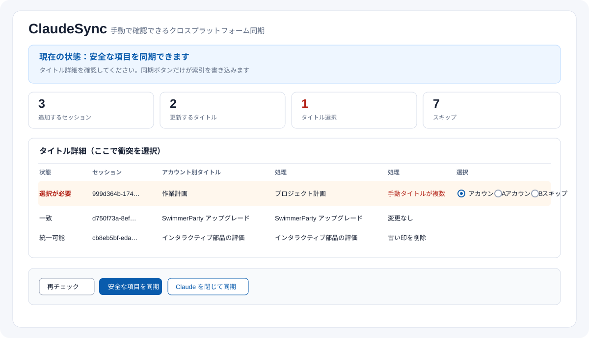
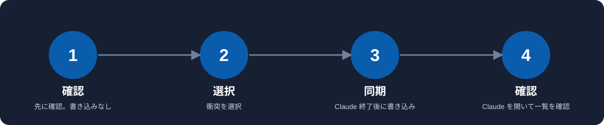

# ClaudeSync（日本語）

**まず確認し、タイトルを選び、安全なときだけ同期。**

[English](README.md) · [中文](README.zh-CN.md) · [Español](README.es.md) · [Português](README.pt-BR.md)

ClaudeSync は、同じコンピューターで使う **2 つ以上の Claude アカウント** のローカル Claude Code セッション一覧を整理します。アカウントフォルダーを自動検出し、計画を表示し、タイトルの衝突を同じ画面で選択してから、Claude の終了後に書き込みます。**役割：**現在は無料共有・自用優先。**技術：**Python デスクトップ GUI/CLI とローカルブラウザー。**状態：**v1.3.3 公開済み。



> **ローカル索引のツールです。クラウド移行ツールではありません。** ログイン、パスワードや Cookie の読み取り、会話のアップロード、Artifact の移動は行いません。

## シンプルな理由

- **最初は自動検出。** ローカルのセッションルートを調べ、見つかったアカウントを一覧にします。不足があるときだけ補助設定を開きます。
- **1 画面で確認。** アカウント、件数、スキップ理由、タイトル選択をまとめて表示します。
- **衝突はセッションごとに1回。** 任意のアカウントの手動タイトルを選ぶか、スキップできます。
- **バックグラウンド動作なし。** 終了フック、監視、タイマー、自動ログイン、自動切替はありません。
- **安全に書き込み。** Claude が動作中は書き込みを止め、書き込み前に索引をバックアップし、後で検証します。



## 対応システム

| システム | 画面 | ローカル同期 | Claude の終了と再起動 |
| --- | --- | --- | --- |
| macOS | 自己完結 GUI | 対応 | 正常終了の要求のみ |
| Windows | Tk GUI | 対応 | ウィンドウ終了の要求のみ |
| Linux | Tk またはローカルブラウザー | ローカル構成がある場合に対応 | 再起動は手動になる場合あり |

Claude の公式ドキュメントでは、本文は通常 `~/.claude/projects` にあり、`CLAUDE_CONFIG_DIR` で場所を変更できると説明されています。ClaudeSync は場所を確認してから使います。[Claude セッション](https://code.claude.com/docs/en/sessions) · [Claude Desktop](https://code.claude.com/docs/en/desktop)

## インストール

[GitHub の最新 Release](https://github.com/PieAIStudio/ClaudeSync/releases/latest) から選んでください。

| システム | ファイル |
| --- | --- |
| macOS Apple シリコン | `ClaudeSync-macos-arm64.dmg` または `.zip` |
| macOS Intel | `ClaudeSync-macos-x64.dmg` または `.zip` |
| Windows 10/11 64 ビット | `ClaudeSync-windows-x64-setup.exe` |
| Debian/Ubuntu 64 ビット | `ClaudeSync-linux-amd64.deb` |
| その他の Linux 64 ビット | `ClaudeSync-linux-amd64.tar.gz` |

画面は简体中文、English、日本語、Español、Português に対応します。macOS 版には Python が含まれます。

## 使い方

### 1. 起動する

インストールして起動すると、最初にローカルのセッションルートを自動確認します。新しく見つかったアカウントも一覧に追加されます。

検出が不完全な場合だけ「アカウント補助設定」を開きます。通常、アカウントを1つずつ入力する必要はありません。

### 2. 確認して選ぶ

1. 「再チェック」を押します。読み取り専用です。
2. 件数とレポートを読みます。
3. 「選択が必要」の行で、任意のアカウントのタイトルまたは「スキップ」を選びます。

### 3. Claude の終了後に同期する

作業を終えてから「安全な項目を同期」を押します。正常終了を任せる場合は「Claude を閉じて同期」を押します。完了後に Claude を開き、一覧を確認してください。ログインとアカウント切替は手動です。

## 複数アカウントの動作

設定したアカウントはすべて同じ立場です。安全なローカル索引の集合を作り、同じ `cliSessionId` を同じ対象へ重複追加しません。どこかのアカウントに削除マーカーがあるセッションは復活させません。アーカイブ、定期タスク、リモート、本文不足などは理由を表示してスキップします。

## タイトルのルール

同じタイトルは変更しません。手動タイトルが1つだけなら自動タイトル側へ安全に反映します。複数の手動タイトルが異なる場合は、1 行で任意のアカウントを選びます。自動タイトル同士の違いは推測しません。選んだタイトルは今回新しく作る入口にも使われます。

## 境界と復元

JSONL の会話本文、既存入口、削除・アーカイブ記録、プロジェクトパス、Artifact、コメント監視、コネクター、リモートセッション、認証情報、Cookie は変更しません。書き込み前に索引のバックアップと manifest を作ります。`config.json`、`reports/`、`backups/` にはローカル情報が含まれるため公開しないでください。

## コマンド

```sh
python sync_sessions.py --check
python sync_sessions.py --sync
python sync_sessions.py --close-sync
```

## 開発

```sh
python -m unittest -v test_sessions test_platforms test_configuration
python -m compileall -q claudesync.py sync_gui.py sync_gui_tk.py sync_web.py sync_sessions.py claude_sync
```

テストは一時フォルダーだけを使います。詳細は [CONTRIBUTING.md](CONTRIBUTING.md)、[SECURITY.md](SECURITY.md)、[MIT License](LICENSE) を参照してください。
