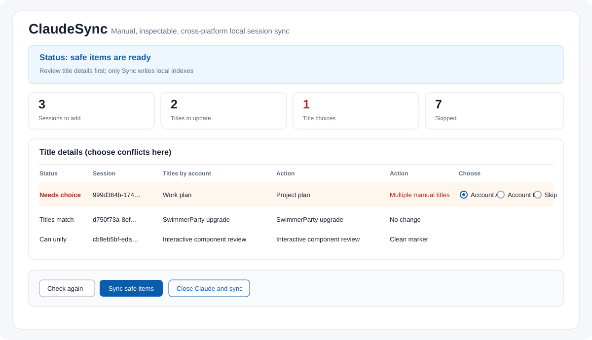
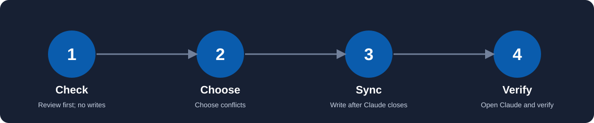

# ClaudeSync

**See it first. Choose the title. Sync only when it is safe.**

[中文](README.zh-CN.md) · [日本語](README.ja.md) · [Español](README.es.md) · [Português](README.pt-BR.md)

ClaudeSync keeps local Claude Code session lists aligned across **two or more accounts** on one computer. It discovers local account folders automatically, shows a readable plan, lets you choose a title once for each conflict, and writes only after Claude has stopped. **Role:** currently free to share, self-use first. **Technology:** Python desktop GUI/CLI with local browser fallback. **Status:** public release v1.3.3.



> **A local index tool, not a cloud migration tool.** ClaudeSync does not log in, read passwords, upload conversations, or move cloud Artifacts.

## Why it is simple

- **Automatic first step.** The app scans the configured Claude session root and finds account folders. You only open the advanced setup when discovery is incomplete.
- **One screen.** Accounts, counts, skipped reasons, and title choices stay together.
- **One decision per conflict.** Choose any account's hand-written title or Skip. The choice is applied to every account that needs the same title.
- **No background automation.** No exit hook, watcher, timer, login hook, or automatic account switching.
- **Safe writes.** A running Claude process blocks writes. ClaudeSync backs up indexes before writing and verifies them afterward.
- **The same core everywhere.** macOS, Windows, and Linux use the same sync rules and local browser fallback.



## What it supports

| System | GUI | Local session sync | Close and reopen Claude |
| --- | --- | --- | --- |
| macOS | Self-contained GUI app | Yes | Graceful request only |
| Windows | Tk GUI | Yes | Graceful window-close request only |
| Linux | Tk GUI or local browser fallback | Yes, when the local Claude layout exists | Reopen may need a manual launch |

Claude's official session documentation says transcripts normally live under `~/.claude/projects` and that `CLAUDE_CONFIG_DIR` can change the location. ClaudeSync lets you confirm the folders instead of guessing. See [Claude Code sessions](https://code.claude.com/docs/en/sessions) and [Claude Desktop](https://code.claude.com/docs/en/desktop).

## Download an installer

Open the [latest GitHub Release](https://github.com/PieAIStudio/ClaudeSync/releases/latest):

| Platform | Download |
| --- | --- |
| macOS Apple silicon | `ClaudeSync-macos-arm64.dmg` or `.zip` |
| macOS Intel | `ClaudeSync-macos-x64.dmg` or `.zip` |
| Windows 10/11 64-bit | `ClaudeSync-windows-x64-setup.exe` |
| Debian/Ubuntu 64-bit | `ClaudeSync-linux-amd64.deb` |
| Other Linux 64-bit | `ClaudeSync-linux-amd64.tar.gz` |

The GUI includes 简体中文, English, 日本語, Español, and Português. If Tk is unavailable on Linux, the package opens the same interface in a local browser. The macOS release includes its Python runtime.

## Use it in three steps

### 1. Open ClaudeSync

Install the package for your system and launch it. On first use ClaudeSync scans the local session root. Newly found account folders appear automatically.

If the scan is incomplete, open **Account fallback settings** and add or remove a folder. This is an exception path; normal use does not require entering accounts one by one.

### 2. Check and choose

1. Click **Check again**. This is read-only.
2. Read the counts and the report.
3. When a row says **Needs choice**, select an account title or **Skip** in that row.

### 3. Sync after Claude stops

Finish current Claude work. Click **Sync safe items**, or click **Close Claude and sync** to request a graceful close. Then open Claude yourself and check the Code list. Login and account switching remain manual.

## Multi-account behavior

Every configured account is a peer. ClaudeSync builds a safe local union: a session can be added to every other account, while the same `cliSessionId` is added only once per target account. If several accounts already contain the session, the existing entries stay in place.

A deletion marker anywhere in the configured set blocks that session from being resurrected. Archived, scheduled, remote, missing-project, and missing-transcript records remain visible with a reason and are not copied.

## Title behavior

- Same title → no change.
- One hand-written title and automatic titles → the hand-written title is offered as the safe choice.
- Several different hand-written titles → one row lists every account title; choose one account or Skip.
- Different automatic titles → ClaudeSync does not guess from activity time.
- Old ClaudeSync branch markers → the original title is restored without adding a new marker.
- A chosen title is also used for newly created entries in that sync.

## Boundaries and recovery

ClaudeSync may add missing local index entries, deterministic branch entries, and explicitly chosen title updates. It does not rewrite JSONL conversation bodies, existing entries, deletion or archive records, project paths, cloud Artifacts, comment monitors, connectors, remote sessions, credentials, or cookies.

Before a write it creates a private, timestamped index backup and manifest. If the operation stops, run **Check again**; already-created entries are detected and existing files are not overwritten. Reports may contain local paths, titles, and account identifiers, so keep `config.json`, `reports/`, and `backups/` private.

## Command line

```sh
python sync_sessions.py --check       # read-only plan
python sync_sessions.py --sync        # apply after Claude is closed
python sync_sessions.py --close-sync  # request a graceful close, then apply
```

Exit code `0` means the command completed; read the report for the actual result. Exit code `1` means a structure, file, or verification error. Exit code `2` means Claude is running, an old automatic process is present, or another ClaudeSync operation holds the lock. Exit code `130` means cancelled.

## Project map

- `claude_sync/core.py` — discovery, multi-account plan, safety checks, writes, verification, and CLI.
- `claude_sync/configuration.py` — automatic discovery, fallback setup validation, and atomic config writes.
- `claude_sync/titles.py` — title provenance, grouped choices, and legacy-marker cleanup.
- `claude_sync/platforms.py` — OS paths, process checks, and graceful close.
- `sync_gui_tk.py` / `sync_web.py` — shared GUI and local browser fallback.
- `docs/multi-account-roadmap.md` — maintainer plan and invariants.
- `ARCHITECTURE.md` — the plain-language maintenance map.

## Development

```sh
python -m unittest -v test_sessions test_platforms test_configuration
python -m compileall -q claudesync.py sync_gui.py sync_gui_tk.py sync_web.py sync_sessions.py claude_sync
```

Tests use temporary directories and never use real Claude data. See [CONTRIBUTING.md](CONTRIBUTING.md), [SECURITY.md](SECURITY.md), and the [MIT License](LICENSE).
