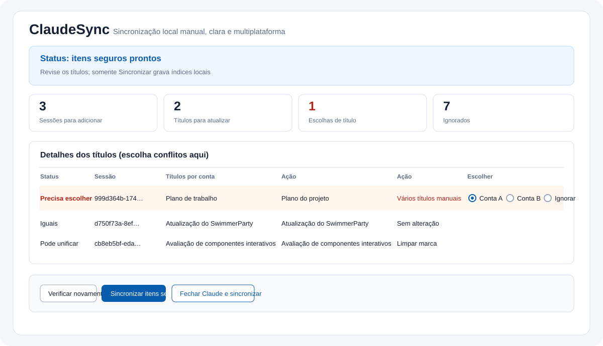

# ClaudeSync (Português)

**Veja primeiro. Escolha o título. Sincronize somente quando for seguro.**

[English](README.md) · [中文](README.zh-CN.md) · [日本語](README.ja.md) · [Español](README.es.md)

O ClaudeSync organiza as listas locais de sessões do Claude Code para **duas ou mais contas** no mesmo computador. Ele descobre as pastas locais, mostra o plano, permite escolher conflitos de título na mesma tela e grava somente depois que o Claude estiver fechado. **Papel:** atualmente gratuito e primeiro para uso próprio. **Tecnologia:** GUI/CLI desktop em Python com navegador local de fallback. **Status:** versão pública v1.3.2.



> **É uma ferramenta de índices locais, não de migração na nuvem.** Não faz login, não lê senhas ou cookies, não envia conversas e não move Artifacts.

## O que torna simples

- **Descoberta automática.** As contas locais aparecem sozinhas. A configuração manual é apenas um caminho de recuperação.
- **Uma tela.** Status, contas, quantidades, motivos ignorados e títulos ficam juntos.
- **Uma escolha por conflito.** Escolha o título de qualquer conta ou **Ignorar**.
- **Sem automação em segundo plano.** Não há gancho de saída, monitor, timer, login ou troca automática de conta.
- **Gravação segura.** Claude em execução bloqueia a gravação; o índice é copiado antes e verificado depois.


## Sistemas e pacotes

| Sistema | Arquivo |
| --- | --- |
| macOS Apple silicon | `ClaudeSync-macos-arm64.dmg` ou `.zip` |
| macOS Intel | `ClaudeSync-macos-x64.dmg` ou `.zip` |
| Windows 10/11 64 bits | `ClaudeSync-windows-x64-setup.exe` |
| Debian/Ubuntu 64 bits | `ClaudeSync-linux-amd64.deb` |
| Outro Linux 64 bits | `ClaudeSync-linux-amd64.tar.gz` |

Baixe na [versão mais recente do GitHub](https://github.com/PieAIStudio/ClaudeSync/releases/latest). A interface inclui 简体中文, English, 日本語, Español e Português. Se o Linux não tiver Tk, a mesma interface abre no navegador local.

## Como usar

1. **Abra o ClaudeSync.** Primeiro ele detecta as contas locais. Se alguma pasta faltar, abra as configurações alternativas e adicione-a.
2. **Verifique.** Clique em **Verificar novamente**, leia as quantidades e veja a tabela.
3. **Escolha.** Em cada linha que precisa de escolha, selecione uma conta ou **Ignorar**.
4. **Sincronize.** Depois que o Claude terminar, clique em **Sincronizar itens seguros** ou **Fechar Claude e sincronizar**.
5. Abra o Claude manualmente e confira a lista. Login e troca de conta continuam manuais.

## Várias contas

Todas as contas configuradas são equivalentes. O ClaudeSync cria uma união local segura: o mesmo `cliSessionId` é adicionado uma vez a cada conta que precisa dele. Um marcador de exclusão em qualquer conta impede que a sessão volte. Itens arquivados, remotos, agendados ou sem transcrição aparecem com o motivo e são ignorados.

## Títulos

Títulos iguais não mudam. Um único título manual pode ser aplicado aos títulos automáticos. Vários títulos manuais diferentes aparecem em uma linha para você escolher qualquer conta. Títulos automáticos diferentes não são adivinhados. O título escolhido também é usado nas novas entradas.

## Limites e recuperação

O corpo JSONL, entradas existentes, exclusões, arquivos, projetos, Artifacts, conectores, sessões remotas, credenciais e cookies não são alterados. Antes da gravação é criada uma cópia privada e um manifest; depois tudo é verificado. Mantenha `config.json`, `reports/` e `backups/` privados, pois podem conter caminhos e nomes locais.

## Comandos

```sh
python sync_sessions.py --check
python sync_sessions.py --sync
python sync_sessions.py --close-sync
```

## Desenvolvimento

```sh
python -m unittest -v test_sessions test_platforms test_configuration
python -m compileall -q claudesync.py sync_gui.py sync_gui_tk.py sync_web.py sync_sessions.py claude_sync
```

Veja [CONTRIBUTING.md](CONTRIBUTING.md), [SECURITY.md](SECURITY.md) e a [licença MIT](LICENSE).
